<!--
  Profile README · Anand Prakash Shukla

  The big cards are self-contained animated SVGs stored in ./assets
  (no outside service involved, so they cannot break or go offline).

  Only two images are live from outside: the streak card and the profile views badge.
  Both use the GitHub username "anandshukla404". If the username ever changes,
  replace it in those two URLs and rename this repository to the new username.
-->

  

  

  

  

  

  

  

  <samp>live demos →
  <a href="https://zenbuddy.netlify.app/">ZenBuddy</a> ·
  <a href="https://pythonmasteryweb.netlify.app/">Python Mastery Web App</a> ·
  <a href="https://anandpshuklaportfolio.netlify.app">Portfolio</a></samp>

  

<samp>$ cat resume.txt</samp> &nbsp;·&nbsp; plain-text version

 

**Anand Prakash Shukla** — Junior Software Engineer

Web developer with hands-on experience in ASP.NET Core, ASP.NET Web Forms, WordPress / Elementor and SQL Server, currently expanding into full-stack development with the MERN stack and Core Python. I integrate multi-state APIs and turn business requirements into user-centric web experiences.

**Experience**

- **Junior Software Engineer** · Sprac Services Pvt. Ltd., Lucknow · Apr 2026 – Present Client: Ministry of Housing and Urban Affairs, New Delhi. State-specific IFMS API integrations (Gujarat, Chhattisgarh and more) for PMAY-U 2.0, web modules in ASP.NET Core / Web Forms on SQL Server, and React.js + Bootstrap components for scheme-monitoring dashboards.
- **Web Developer Intern** · K2 Technologies, remote · Jun 2025 – Apr 2026 Responsive client websites with HTML, CSS, JavaScript and WordPress / Elementor; CMS sites tuned for performance, SEO and cross-browser support.

**Projects**

- **PMAY-U 2.0 – IFMS Multi-State API Integration** · ASP.NET Web Forms, C#, SQL Server (SSMS)
- **[ZenBuddy](https://zenbuddy.netlify.app/)** – mental health companion (major project) · MERN stack, Firebase
- **[Python Mastery Web App](https://pythonmasteryweb.netlify.app/)** – interactive Python learning platform · HTML, CSS, JavaScript
- **Voice-Activated Virtual Assistant** · Python, speech recognition, text-to-speech
- **Typing Speed Game with To-Do List** · Python, Tkinter

**Skills**

- **Languages:** JavaScript, Python, C#
- **Backend & database:** ASP.NET Core, ASP.NET Web Forms, RESTful APIs, SQL Server (SSMS)
- **Frontend:** HTML, CSS, Bootstrap, Tailwind CSS
- **CMS & tools:** WordPress, Elementor, Wix, WooRank SEO, Canva, Git, GitHub
- **Learning now:** MERN stack (MongoDB, Express.js, React, Node.js), AI / ML

**Education** — B.Tech, Computer Science & Engineering · Vision Institute of Technology, Kanpur · 2021 – 2025

**Portfolio** — [anandpshuklaportfolio.netlify.app](https://anandpshuklaportfolio.netlify.app)

  

  

